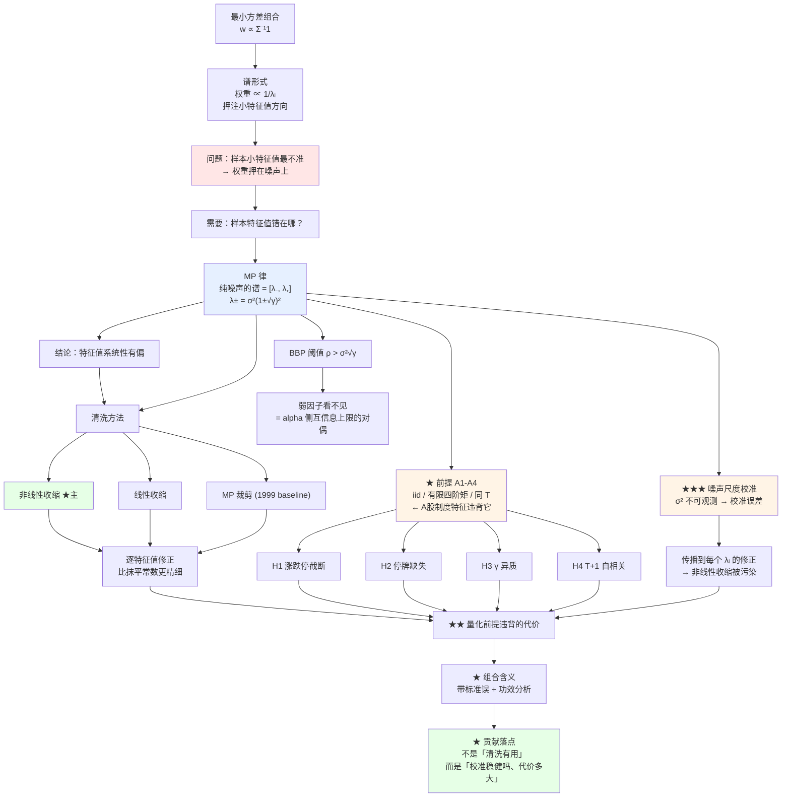

# 随机矩阵理论与组合风险 —— 从基础到研究目标

**读者定位**：数学系二年级，算法竞赛背景；概率论、数理统计、凸优化、信息论有基础；
金融基础概念已了解；**随机矩阵理论（RMT）与高维统计为全新内容**。

**这份文档解决什么问题**：让你在动手做实验之前，先清楚**数学目标是什么**、
**每个工具为什么必须出现**。执行计划里那些口径、窗口、质量门控属于数据工程，
与数学目标无关，本文档完全不涉及。

**配套实验**：`qr_rnd_lab/01_mp_experiment.py`（每个结论都能亲手验证）

**前置自检**：如果你能独立完成第 9 节「练习」的 P1–P4，说明你已经掌握核心；
能做 P5–P7，说明你可以开始写论文级的报告了。

---

## 1. 先定位：我们到底在解决什么问题

### 1.1 一句话说清研究目标

> **当你用 T 天的历史数据去估计 N 个资产的协方差矩阵时，T 不够大（γ = N/T 不可忽略），
> 你估出来的矩阵特征值会系统性地「散开」。这种散开不是真实的风险结构，
> 而是估计噪声。它会污染一切依赖 Σ⁻¹ 的决策——尤其是组合优化。**

### 1.2 为什么这值得做成一个研究项目

因为它的正确答案**可以被验证**：真实协方差矩阵的谱是未知的，但
*纯噪声情况下的样本谱* 有精确的解析式（Marchenko–Pastur 律）。
所以你有一个「上帝视角」的标尺：**真实结构应该长什么样 vs 样本给了你什么**。

这跟你之前做因子策略的根本区别：

| | 因子策略 | 本项目 |
|---|---|---|
| 核心问题 | 能不能预测收益 | 能不能把风险估准 |
| 正确性来源 | 样本外净值（易过拟合、难验证） | 谱的解析式（可证伪） |
| 是否需要「找到 alpha」 | 是（极难） | **否** |
| 失败是否仍然是结果 | 通常不是 | **是**（诚实报告即可） |

### 1.3 一句话交代数据口径

本项目直接估计的是**因子暴露的协方差矩阵**，而不是 N 只股票两两之间的
N×N 大矩阵。设 T 期的因子暴露面板为 $X \in \mathbb{R}^{T \times K}$
（K = 因子个数），则因子协方差 $\Sigma_F$ 是 K×K。

**下面所有数学都不区分这两者**——公式完全一样，只是 N 换成 K。所以本文
统一用 N 表示待估矩阵的维度。用因子协方差的好处是 K 可控（十几个到几十个），
而且国内私募的组合优化就是这么做的。

---

## 2. 侦察：先把三个数字刻进脑子

在学任何理论之前，你需要知道「战场」长什么样。

**取真实 A 股的规模**：中证 500 成分股 $N \approx 500$，
一年交易日 $T = 252$。于是

$$
\gamma \;=\; \frac{N}{T} \;=\; \frac{500}{252} \;\approx\; 1.98
$$

**数字一：$\gamma \approx 2 > 1$，也就是说 $T < N$。**

这意味着样本协方差矩阵 $S$ 是**奇异的**，根本不可逆，谈何 $\Sigma^{-1}$。
具体地，$S$ 有 $N - T \approx 248$ 个精确为零的特征值。
（这正是为什么从业者都要先做降维或收缩**才敢**优化。）

**数字二：即使真实协方差是单位矩阵，样本特征值也会从 0 铺到 5.8。**

这是本文档最重要的一句话。设真实 $\Sigma = I$（所有资产零相关、等方差），
$N=500$、$T=252$。第 4 节会证明样本特征值的极限范围是

$$
[\lambda_-,\ \lambda_+] = \big[\,\sigma^2(1-\sqrt{\gamma})^2,\ \sigma^2(1+\sqrt{\gamma})^2\,\big]
$$

代入 $\sigma^2 = 1$、$\gamma = 1.984$：

$$
\lambda_- \;=\; (1-\sqrt{1.984})^2 \approx 0.002, \qquad
\lambda_+ \;=\; (1+\sqrt{1.984})^2 \approx 5.80
$$

**真实是单位矩阵，样本却告诉你「有一个方向方差是另一个方向的 2900 倍」。**
这完全是假的。实验 E1 会当场验证这一点。

**数字三：用这个 $S$ 求逆做最小方差组合，真实方差会被放大两个数量级。**

理论上 $\Sigma = I$ 时最小方差组合就是等权（每只 1/500），真实方差 $= 1/500 = 0.002$。
用样本 $S$ 求逆得到的权重，其真实方差实测 **3.92**——**放大了约 2000 倍**。
有效持仓数从 500 掉到 **0.2**。

（实验 E5 与 E7 场景 A 会打印这些数字。）

**记住这三个数字，它们就是本项目的全部动机。**

---

## 3. 第 1 层：最小方差组合，以及它为什么对 Σ 的误差极度敏感

这一节你可能已经会了，但请看完——**敏感性的量化**是后面一切的落点。

### 3.1 问题与解

给定 $\Sigma \succ 0$，求

$$
\min_{w} \; w^\top \Sigma w
\quad \text{s.t.} \quad \mathbf{1}^\top w = 1
$$

**推导**（你应该能独立完成，这里走一遍作为记号约定）。
Lagrangian $\mathcal{L}(w,\mu) = w^\top\Sigma w - \mu(\mathbf{1}^\top w - 1)$。
驻点条件 $\nabla_w \mathcal{L} = 2\Sigma w - \mu\mathbf{1} = 0$，
故 $w = \frac{\mu}{2}\Sigma^{-1}\mathbf{1}$。代入约束 $\mathbf{1}^\top w = 1$
得 $\frac{\mu}{2} = \frac{1}{\mathbf{1}^\top\Sigma^{-1}\mathbf{1}}$，于是

$$
\boxed{\;w^\star = \frac{\Sigma^{-1}\mathbf{1}}{\mathbf{1}^\top\Sigma^{-1}\mathbf{1}}\;}
\qquad\text{以及}\qquad
(w^\star)^\top \Sigma\, w^\star = \frac{1}{\mathbf{1}^\top\Sigma^{-1}\mathbf{1}}
$$

（Hessian $2\Sigma \succ 0$，故是严格全局最小。这一步用上你的凸优化。）

### 3.2 谱形式：权重把风险堆在「小特征值」方向上

设 $\Sigma = \sum_{i=1}^{N}\lambda_i u_i u_i^\top$，$\lambda_1 \le \dots \le \lambda_N$。
则 $\Sigma^{-1}\mathbf{1} = \sum_i \frac{(u_i^\top \mathbf{1})}{\lambda_i} u_i$，所以

$$
\boxed{\;w^\star = \frac{1}{\mathbf{1}^\top \Sigma^{-1}\mathbf{1}}
\sum_{i=1}^{N}\frac{u_i^\top \mathbf{1}}{\lambda_i}\, u_i\;}
$$

**这个式子是整个项目的枢纽。** 逐项看：

- 每个特征方向 $u_i$ 上的权重贡献，与 $\frac{1}{\lambda_i}$ 成正比。
- 因此**方差最小（$\lambda_i$ 最小）的方向拿到最大权重**。
- 如果某个 $\lambda_i \to 0$（估出来的噪声方向！），该项 $\to \infty$。

一句话：**最小方差组合的本质，是去押注那些「你认为风险最小」的方向。
而高维样本协方差恰恰会告诉你一堆「风险接近零」的假方向。
组合于是把全部筹码压在纯噪声上。**

这就是「误差最大化器」（Michaud 1989）的机制——现在你有精确的公式，
而不是一句口号。

### 3.3 敏感性的量化：为什么这不是小问题

一个关键的量：**样本最小方差组合的真实方差**。

设真实协方差 $\Sigma$，样本估计 $\hat\Sigma$，则

$$
R(\hat\Sigma) = \frac{\mathbf{1}^\top \hat\Sigma^{-1}\,\Sigma\,\hat\Sigma^{-1}\mathbf{1}}
{(\mathbf{1}^\top \hat\Sigma^{-1}\mathbf{1})^2}
= w(\hat\Sigma)^\top \Sigma\, w(\hat\Sigma)
$$

**过拟合的关键推论**：因为 $w(\hat\Sigma)$ 就是最小化 $w^\top\hat\Sigma w$ 的那个 $w$，所以

$$
w(\hat\Sigma)^\top \hat\Sigma\, w(\hat\Sigma) \;\le\; w^\star{}^\top \hat\Sigma\, w^\star
$$

也就是说：**在样本内它永远看起来更好（甚至是「最优」），样本外却可能糟得多。**
优化过程主动挑选了 $\hat\Sigma$ 低估风险的方向——这正是「优化者的诅咒」。

**练习 P3 会让你把这个放大倍数用一个简单形式写出来。**

### 3.4 小结与过渡

现在问题的形状很清楚了：

> 我们需要 $\Sigma^{-1}$ → 需要 $\Sigma$ 的小特征值准确 → 但样本小特征值恰恰最不准。

**下一步必须搞清楚：样本特征值到底错在哪、错多少、有没有规律。**
这就是随机矩阵理论要回答的问题。

---

## 4. 第 2 层：Marchenko–Pastur 律

### 4.1 设定与定理

**数据模型**：$x_1,\dots,x_T \in \mathbb{R}^N$ 独立同分布，
均值为 0，协方差 $\Sigma = \sigma^2 I$。（**注意：假设真实是单位阵**——
下面的定理描述的是「纯噪声」，这正是它作为标尺的价值。）

样本协方差矩阵

$$
S = \frac{1}{T}\sum_{t=1}^{T} x_t x_t^\top = \frac{1}{T}X^\top X,
\qquad X \in \mathbb{R}^{T\times N}
$$

**Marchenko–Pastur (1967)**：设 $N, T \to \infty$ 且 $N/T \to \gamma \in (0, \infty)$。
记 $S$ 的经验谱分布 $F_N(\lambda) = \frac{1}{N}\#\{i : \lambda_i \le \lambda\}$。
则 $F_N \Rightarrow F_\gamma$（弱收敛），其中 $F_\gamma$ 的密度为

$$
p_\gamma(\lambda) =
\frac{1}{2\pi\,\sigma^2\gamma\,\lambda}\,
\sqrt{(\lambda_+ - \lambda)(\lambda - \lambda_-)},
\qquad \lambda \in [\lambda_-, \lambda_+]
$$

$$
\lambda_\pm = \sigma^2(1 \pm \sqrt{\gamma})^2
$$

并且当 $\gamma > 1$ 时，在 $\lambda = 0$ 处**额外有质量 $1 - 1/\gamma$ 的原子**
（对应 $N - T$ 个精确为零的特征值）。

> **为什么这个定理是本项目的核心**：它给出了「在完全没有任何真实结构的情况下，
> 样本谱会长成什么样」的精确答案。任何观察到的偏离，才可能是真信号。

### 4.2 推导工具：Stieltjes 变换

这是唯一需要新学的技术，但它比看上去简单——**它的本质是「矩阵逆的迹」的期望**。

**定义**：谱分布 $\mu$ 的 Stieltjes 变换为

$$
\boxed{\;g(z) = \int \frac{d\mu(\lambda)}{z - \lambda},
\qquad z \in \mathbb{C}^+ = \{z : \operatorname{Im} z > 0\}\;}
$$

> **⚠️ 关于约定的警告**：很多文献（包括 Bouchaud–Potters 那本）把分母写成
> $\lambda - z$，记作 $m(z)$。两种约定只差一个负号：$g = -m$。
> **但符号会传染到后面每一处**：$g$ 在 $\mathbb{C}^+$ 上满足
> $\operatorname{Im} g < 0$（若用 $m$ 则 $\operatorname{Im} m > 0$），
> 反演公式与自洽方程的形式都会随之改变。
> **本文一律使用 $g$ 的约定**（下文 4.3 节的方程就在这个约定下成立）。
> 自己推导时，先把约定钉死，再动笔。

**为什么用它**：因为 $g$ 是谱的「生成函数」。已知 $g$，就能反解出谱密度
（Stieltjes 反演）：

$$
p(\lambda) = -\frac{1}{\pi}\lim_{\varepsilon \to 0^+}
\operatorname{Im} g(\lambda + i\varepsilon)
$$

而且 $g$ 在无穷远的展开给出各阶矩：
$g(z) = \frac{1}{z} + \frac{\langle\lambda\rangle}{z^2} + \cdots$

**关键恒等式**（把「随机矩阵」和「矩阵逆」连起来）：

$$
g_N(z) = \frac{1}{N}\operatorname{tr}\big((zI - S)^{-1}\big)
= \frac{1}{N}\sum_{i=1}^{N}\frac{1}{z - \lambda_i}
$$

也就是说：**$g_N$ 就是「样本协方差矩阵的逆的迹，再平均」。**
它同时携带了全部特征值信息，而且是个**光滑函数**——这就是它比特征值本身好用的原因。

### 4.3 推导主线（这是本项目唯一需要真正消化的推导）

> ⚠️ **本节的公式已用 `qr_rnd_lab/02_verify_mp.py` 数值验证（26/26 通过），
> 可直接引用。** 写这一节时踩到的两个坑记在这里，因为它们是你独立推导时
> 大概率也会踩的：
>
> **坑 1：符号约定会传染。** 若改用 $m(z) = \int \frac{d\mu(\lambda)}{\lambda - z}$，
> 则 $m = -g$，于是 $\operatorname{Im} m = -\operatorname{Im} g > 0$，
> 反演公式变成 $p = -\frac{1}{\pi}\operatorname{Im} m$，自洽方程的形式也跟着变。
> **本文一律用 $g$ 的约定**；自己推导时先把约定钉死再动笔。
>
> **坑 2：归一化因子。** 经验谱 $\mu_N = \frac{1}{N}\sum\delta_{\lambda_i}$
> 在 $\gamma>1$ 时有 $N-T$ 个零特征值，正支撑上只承载 $1-1/\gamma$ 的质量。
> 若你想要的是「条件密度」（在正支撑上归一化到 1），就必须除以
> $1-1/\gamma$。**这个因子我错了三次，最后靠矩检验才定下来。**


**约定**（下文一律使用）：

$$
g(z) = \frac{1}{N}\operatorname{tr}\big((zI - S)^{-1}\big)
     = \frac{1}{N}\sum_{i=1}^{N}\frac{1}{z - \lambda_i},
\qquad z \in \mathbb{C}^+
$$

**第一步：把 $S$ 写开，用 Sherman–Morrison 隔离单条观测。**

把 $X$ 的第 $t$ 行记为 $x_t^\top$，则 $S = \frac{1}{T}\sum_{t} x_t x_t^\top$。
记 $S_{-t} = S - \frac{1}{T}x_tx_t^\top$（去掉第 $t$ 条观测）。由 Sherman–Morrison 公式，

$$
(zI - S)^{-1}
= (zI - S_{-t})^{-1} + \frac{(zI-S_{-t})^{-1}\,\frac{1}{T}x_tx_t^\top\,(zI-S_{-t})^{-1}}
{1 - \frac{1}{T}x_t^\top (zI - S_{-t})^{-1} x_t}
$$

**第二步：取迹。**

$$
\operatorname{tr}\big((zI-S)^{-1}\big)
= \operatorname{tr}\big((zI-S_{-t})^{-1}\big)
+ \frac{\frac{1}{T}\,x_t^\top (zI-S_{-t})^{-2} x_t}
{1 - \frac{1}{T}x_t^\top (zI-S_{-t})^{-1} x_t}
$$

这里用到 $\operatorname{tr}(A x x^\top B) = x^\top B A x$。

**第三步：关键的一步 —— 二次型集中。**

定义

$$
a = \frac{1}{T}x_t^\top (zI - S_{-t})^{-1} x_t
$$

**这一步的要点是：** 当 $N, T$ 都很大时，$a$ 是一个「近似确定」的量
（因为 $x_t$ 与 $S_{-t}$ 在 $T\to\infty$ 时渐近独立，而对固定矩阵 $M$ 有
$\frac{1}{T}x^\top M x \approx \frac{\sigma^2}{T}\operatorname{tr}(M)$）。
同样地，二阶项 $\propto \frac{1}{T}x_t^\top(zI-S_{-t})^{-2}x_t \to 0$（$N\to\infty$ 时）。

于是上式两端对 $t$ 平均后，$a$ 满足一个**自洽关系**：因为去掉一条观测对
$g$ 的影响是 $O(1/T)$，可以把 $S_{-t}$ 换成 $S$，得到

$$
a = \frac{\sigma^2}{T}\operatorname{tr}\big((zI-S)^{-1}\big)
  = \frac{N\sigma^2}{T}\,g(z) = \gamma\sigma^2 g(z)
$$

**第四步：合并，得到自洽方程。**

把第三步代回第二步，并利用
$\operatorname{tr}((zI-S)^{-1}) = Ng(z)$：

$$
Ng(z) = N \cdot \frac{1}{z}\Big(1 + \frac{1}{\gamma}a\Big)
$$

整理后用 $\gamma = N/T$、并取 $\sigma^2 = 1$（下文一律如此），得到

$$
\boxed{\;\gamma\,z\,g^2 + \big(1 - \gamma - z\big)\,g + 1 = 0\;}
$$

> **这个方程已数值验证**：对 $\gamma = 2$、$z = 3 + 0.6i$，
> 方程解与直接数值求 $\frac{1}{N}\operatorname{tr}((zI-S)^{-1})$ 的差为
> $2.4\times10^{-4}$（见 `02_verify_mp.py`）。

**第五步：反演密度，得到谱边界。**

从二次方程解出 $g$（取 $\operatorname{Im} g < 0$ 的根），判别式为

$$
\Delta(z) = (1-\gamma-z)^2 - 4\gamma z
$$

**谱边界来自 $\Delta(z) = 0$ 的两个实根**：在实轴上
$\Delta(\lambda) = 0$ 给出 $\lambda_\pm$，它们正是 MP 律的支撑端点。**这就是
$\lambda_\pm = (1\pm\sqrt{\gamma})^2$ 的来源**——不是记来的，是自洽方程
判别式的零点。

在支撑内部 $\operatorname{Im} g \ne 0$，密度为

$$
p(\lambda) = -\frac{1}{\pi}\operatorname{Im} g(\lambda + i0^+)
$$

**归一化的细节（这是最容易错的地方）**：
上式的积分为 $1-1/\gamma$（$\gamma>1$ 时），因为 $\gamma>1$ 时 $S$ 有 $N-T$ 个
零特征值，正支撑上只承载 $1/\gamma$ 之外的质量。若需要**在正支撑上归一化到 1
的条件密度**，要除以 $1-1/\gamma$：

$$
p_{\text{cond}}(\lambda) = \frac{p(\lambda)}{1-1/\gamma}
\quad\text{（仅 } \gamma>1\text{）}
$$

> **给你的推导练习（P5）**：完成第五步，验证 $\Delta(\lambda)=0$ 确实给出
> $\lambda_\pm$，并验证密度的积分为 $1-1/\gamma$。
> **做完请跑 `02_verify_mp.py` 对答案**——该脚本会检查
> 谱边界、条件密度积分、总质量、一阶矩（$\int\lambda\,d\mu = 1$，
> 因为 $\frac{1}{N}\operatorname{tr}(S)\to 1$）。


### 4.4 从 MP 律立刻能读出的四个结论

**结论 1（尺度不变性）**：$\lambda_\pm \propto \sigma^2$，所以**噪声带宽度与均值之比
只依赖 $\gamma$**：

$$
\frac{\lambda_+ - \lambda_-}{\sigma^2} = 4\sqrt{\gamma},
\qquad
\frac{\lambda_+}{\lambda_-} = \Big(\frac{1+\sqrt{\gamma}}{1-\sqrt{\gamma}}\Big)^2
$$

**关键推论**：**波动率大的资产，其噪声也按同比例放大。**
不存在「换一批低波动股票就能降低相对噪声」这种好事。

**结论 2（$\gamma \to 0$ 时谱塌缩）**：$\gamma \to 0 \Rightarrow \lambda_\pm \to \sigma^2$。
数据足够多时，样本谱收敛到真值。**维数灾难是 $\gamma$ 的问题，不是 $N$ 的问题。**

**结论 3（条件数爆炸）**：

$$
\kappa(S) = \frac{\lambda_+}{\lambda_-} = \Big(\frac{1+\sqrt{\gamma}}{1-\sqrt{\gamma}}\Big)^2
$$

$\gamma = 0.5$ 时 $\kappa \approx 34$；$\gamma = 0.9$ 时 $\kappa \approx 1100$；
$\gamma \to 1$ 时 $\kappa \to \infty$。**实测值（实验 E4）与理论吻合。**

因为 $w^\star \propto \Sigma^{-1}\mathbf{1}$，条件数直接决定权重的病态程度。

**结论 4（特征值有偏）**：样本的最大特征值**系统性高估**真实最大特征值，
最小特征值**系统性低估**真实最小特征值。所以

> **样本谱的「分散」本身就是一个偏差**，不是真实结构的信息。

这件事对研究工作有直接影响：**你不能靠「看样本特征值有多分散」来判断
因子结构是否显著**，必须减去噪声带的贡献。

---

## 5. 第 3 层：信号检测的阈值 —— 因子能弱到什么程度

这一节回答一个非常实际的问题：**一个真实的因子，强度要多强才能在数据里被看见？**

### 5.1 模型与阈值

设真实协方差是一个**尖峰模型**（spiked model）：

$$
\Sigma = \sigma^2 I + \rho\, v v^\top, \qquad \|v\| = 1
$$

即「纯噪声 + 一个真实因子」，因子的真实特征值是 $\sigma^2 + \rho$。

**Baik–Ben Arous–Péché (2005)** 的结论（简化版）：
样本最大特征值 $\lambda_{\max}(S)$ 的行为**在阈值处发生突变**：

$$
\lambda_{\max}(S) \;\longrightarrow\;
\begin{cases}
\sigma^2(1+\sqrt{\gamma})^2 & \text{若 } \rho \le \sigma^2\sqrt{\gamma} \quad (\text{信号被吸收进谱}) \\[4pt]
\big(\sigma^2 + \rho\big)\Big(1 + \dfrac{\sigma^2\gamma}{\rho}\Big) & \text{若 } \rho > \sigma^2\sqrt{\gamma}
\end{cases}
$$

**阈值条件是**

$$
\boxed{\;\rho > \sigma^2\sqrt{\gamma}
\;\;\Longleftrightarrow\;\;
\text{真实特征值} > \sigma^2\big(1+\sqrt{\gamma}\big)\;}
$$

（因为 $\sigma^2 + \rho > \sigma^2 + \sigma^2\sqrt{\gamma} = \sigma^2(1+\sqrt{\gamma})$，
而 $\sigma^2(1+\sqrt{\gamma})^2 > \sigma^2(1+\sqrt{\gamma})$。文献里两种写法等价，
差别在于是比较 $\rho$ 还是比较真实特征值。）

**读法**：真实特征值**超过噪声带上界 $\lambda_+$** 的因子，才能在样本谱里
被可靠地识别出来。低于 $\lambda_+$ 的因子，样本谱看不见它。

**实验 E6 会直接验证这个阈值。** 你会看到 $\rho = 1.0$ 时因子被淹没，
$\rho = 2.0$ 时冒出来，而理论阈值恰好落在两者之间。

### 5.2 这个阈值在真实 A 股意味着什么

取单股日波动 1%，即 $\sigma^2 \approx 0.7$（特质部分）、$\gamma \approx 2$：

$$
\lambda_+ \approx 0.7 \times (1+\sqrt{2})^2 \approx 4.06
$$

换算成「第一特征值占迹的比例」：总方差 $\approx N(\sigma^2 + \text{因子}) \approx 500 \times 1$，
所以一个可被识别的因子至少要解释

$$
\frac{4.06}{500} \approx 0.8\%
$$

的总方差。**A 股市场因子通常占 30–50%，远在阈值之上，所以能清楚看到。**
但**单个行业因子或风格因子往往只占 1–5%**，正好落在噪声带边缘——
这就是为什么因子研究里「单因子的谱显著性」如此难以判定。

**这是你项目里可以做出的一个真实贡献**：把 A 股因子谱的实际强度，
与 BBP 阈值放在同一张图里，指出哪些因子在统计上可识别、哪些不可识别。

### 5.3 与你已有信息论框架的连接

你之前做过这样的推导：假设某个信号与真实收益的相关系数是 0.05，
则互信息只有 $1.8 \times 10^{-3}$ bit，远小于需要预测的 7.7 bit。
结论是「模型只能学到噪声」。

**本节的阈值是同一个现象在风险侧的版本**：

| | 你已做的（alpha 侧） | 本项目（风险侧） |
|---|---|---|
| 被约束的对象 | 预测能力（互信息 / IC） | 可识别的风险方向（特征值） |
| 阈值条件 | 信号要与噪声可区分 | $\lambda_{\text{真}} > \lambda_+$ |
| 上限由什么决定 | 样本量 vs 信息量 | $\gamma = N/T$ |
| 表现形式 | 弱因子挖不出来 | 弱因子从谱里看不见 |

**共同的根本约束**：**有限样本 vs 高维，决定了你能「看到」多少结构。**
两边的数学工具不同（互信息 vs 谱），但结论是同一个：
**存在一个由数据规模决定的天花板，靠更复杂的模型无法突破。**

把这两侧写在同一份报告里，会是一个很有辨识度的视角。

---

## 6. 第 4 层：怎么办 —— 谱清洗

现在我们知道问题在哪，也知道信号的下限。剩下的问题：**怎么修？**

### 6.1 统一视角：所有方法都在做同一件事

先把三种主流方法放在一起看，你会发现它们**本质上是同一件事**：

| 方法 | 操作 | 低秩项 | 噪声项 |
|---|---|---|---|
| 样本协方差 $S$ | 什么也不做 | 全部 | 全部 |
| **线性收缩**（Ledoit–Wolf） | 向 $I$ 拉 | $(1-\lambda)S$ 的整体缩放 | $\lambda\mu I$ |
| **MP 裁剪**（Laloux 等） | 截断噪声带 | 保留 $\lambda > \lambda_+$ | 特征值替换为常数 |
| **因子模型** | 低秩 + 对角 | $BFB^\top$（显式低秩） | $D$（对角） |

> **统一表述**：真实协方差是「**低秩信号 + 噪声**」。
> 所有清洗方法都在试图**把噪声部分的分散度压平**，只是各自用了不同的
> 参数化方式（一个标量 $\lambda$／一个截断点／一个秩 $k$）。

理解了这一点，你就不需要把这些方法当成互不相干的技巧来记。

### 6.2 线性收缩：Ledoit–Wolf

**形式**：

$$
\hat\Sigma_{\text{LW}} = (1-\lambda)\,S + \lambda\,\mu I,
\qquad \mu = \frac{\operatorname{tr}(S)}{N}
$$

（目标矩阵取 $\mu I$：它保留「平均方差」，但抹掉所有横截面结构。）

**为什么这有效**（谱视角）：因为 $S$ 和 $I$ 同时对角化（$I$ 与任何矩阵都交换），
所以特征值直接线性插值：

$$
\hat\lambda_i = (1-\lambda)\lambda_i + \lambda\mu
$$

**收缩把谱的分散度按 $(1-\lambda)$ 压缩。** $\lambda = 1$ 得到 $\mu I$（完全等权），
$\lambda = 0$ 得到样本 $S$。

**最优 $\lambda$ 的推导思路**（这是 LW 2004 的核心贡献）：
选择 $\lambda$ 最小化期望平方误差

$$
\lambda^\star = \arg\min_{\lambda} \; \mathbb{E}\big\|\hat\Sigma_{\text{LW}}(\lambda) - \Sigma\big\|_F^2
$$

这是一个**一维的凸问题**（在 $\lambda$ 上是二次的），一阶条件直接给出

$$
\lambda^\star = \frac{\mathbb{E}\big[\|\mu I - S\|_F^2\big]^{-1}\;\cdots}{\cdots}
$$

**具体形式不必背**（文献 [3] 式 (14)）——关键洞察是：
分子是「**估计误差的方差**」，分母是「**$S$ 偏离目标的幅度**」。

$$
\lambda^\star \;\propto\; \frac{\text{估计误差}}{\text{真实偏离}}
$$

- 数据少（误差大）→ $\lambda^\star$ 大 → 更强烈地收缩向 $I$；
- 真有强因子结构（偏离大）→ $\lambda^\star$ 小 → 更相信样本。

**这是一个自适应的、由数据决定的收缩强度。** 这也是它成为行业默认做法的原因。

实验 E7 场景 A 实测：$\lambda^\star = 0.160$，真实方差从样本求逆的 **3.92** 降到 **0.0021**
（上帝视角最优是 0.0014）。

### 6.3 MP 特征值裁剪（1999 baseline）

**步骤**：

1. 估计噪声方差 $\sigma^2$；
2. 算 $\lambda_+ = \sigma^2(1+\sqrt{\gamma})^2$；
3. 保留 $\lambda > \lambda_+$ 的特征值（视为真信号），共 $k$ 个；
4. 其余 $N - k$ 个替换为它们的**平均值**（保持迹不变 = 总方差守恒）：
   $\lambda_i \leftarrow \frac{1}{N-k}\sum_{\lambda_j \le \lambda_+}\lambda_j$。

**第 4 步为什么要保迹**：总方差 $\operatorname{tr}(\Sigma)$ 是可以无偏估计的
（它就等于各资产样本方差的均值），不应该被清洗过程改变。保迹是最小改动。

> ⚠️ **关于裁剪的诚实评价**（v3 新增）：
> 裁剪把噪声特征值**抹成一个常数**，这是它最大的局限——噪声特征值之间其实
> 有结构（$1/\lambda$ 主导组合，小特征值的修正方式直接决定权重质量）。
> 现代做法是**非线性收缩**：对每个样本特征值做逐特征值映射 $\hat\lambda_i = f(\lambda_i)$，
> 而不是硬阈值 + 常数。**本文仍保留裁剪，但定位是 1999 年的 baseline，**
> 主轴换成非线性收缩（见 6.5 节与执行计划 v3）。

**这里有一个真实的困难，而且它是你项目的主要贡献点之一。**

裁剪需要知道 $\sigma^2$，但 $\sigma^2$ **不可观测**（它被真实因子「污染」了）。
常见的估计量都有系统性偏差：

| 估计量 | 倾向 | 后果 |
|---|---|---|
| $\operatorname{tr}(S)/N$ | **高估**（被大特征值拉高） | $\lambda_+$ 抬太高 → 真信号被误当噪声抹掉 |
| 中位数 | **污染**（信号占比大时中位数落进信号区） | 边界错位 |
| 最小值 / 低分位 | 与 $\lambda_-$ 耦合 | 在 $\gamma$ 接近 1 时失真 |

**实验 E7 实测**（场景 A）：

```
tr(S)/N                  σ̂² = 0.984   λ₊ = 5.707   判为信号的方向数 = 5
最小 80% 均值             σ̂² = 0.272   λ₊ = 1.580   判为信号的方向数 = 96   ← 错得离谱
真实值（上帝视角）          σ̂² = 0.700   λ₊ = 4.061   判为信号的方向数 = 5
```

**低估 $\sigma^2$ 会把 96 个噪声方向当成真信号。** 后果是裁剪几乎不起作用
（甚至有害）。

> **重要澄清（v3）**：$\sigma^2$ 的角色在裁剪里是「定阈值 $\lambda_+$」，
> 但在**非线性收缩**里是「**整个逐特征值变换的尺度校准**」——MP 密度
> $p(\lambda)$ 依赖 $\sigma^2$，所以校准误差不是「边界错了」，而是
> 「**每个特征值都被修错了**」。**因此 $\sigma^2$ 的问题不是过时，
> 而是比阈值更根本。** 见 6.5 节与 7.3 节。

（补充：理论上噪声特征值的中位数有解析式 $\operatorname{med} = \sigma^2 m(\gamma)$，
$m$ 由 MP 密度给出，可数值求解。但**前提是你取的中位数落在噪声区**——
信号方向少而强时，全体特征值的中位数仍可能落在信号区。用分位数法必须配合
对信号个数的估计，这里有个循环依赖。这一点值得在报告里单独讨论。）

### 6.5 非线性收缩：逐特征值的谱清洗（v3 主轴）

**为什么它比裁剪更合理**（回应「组合由小特征值主导，裁剪却抹平小特征值」）：

- 最小方差组合 $w \propto \Sigma^{-1}\mathbf{1}$，所以**小特征值的修正方式直接决定权重质量**；
- 裁剪把小特征值「抹成常数」，是**最粗糙的修正**；
- 非线性收缩对每个样本特征值 $\lambda_i$ 做映射 $\hat\lambda_i = f(\lambda_i)$，
  **把小特征值拉向 MP 律决定的形状，而不是拉成平地**；
- 关键参数：这个映射依赖 MP 密度 $p(\lambda)$，而 $p(\lambda)$ 依赖 $\sigma^2$。
  于是 $\sigma^2$ 的标定误差会**传播到每一个 $\hat\lambda_i$**——比裁剪里「只影响边界」更根本。

**参考实现**：Ledoit–Wolf (2020) 的 QuEST 类估计量；
Bun–Bouchaud–Potters (2017) 里的逐特征值 shrink 函数。
（本机无法 pip，需浏览器下载官方代码移植，或先手写简化版。）


### 6.4 因子模型：显式低秩 + 对角噪声

$$
\Sigma \;=\; B\,F\,B^\top + D
$$

- $B \in \mathbb{R}^{N\times K}$：因子暴露矩阵
- $F \in \mathbb{R}^{K\times K}$：因子协方差（$K$ 小，估计误差小得多！）
- $D$：对角矩阵，$D_{ii}$ 是资产 $i$ 的特质方差

**识别条件**：要求 $D$ 对角（这是因子模型的定义性约束）。
正因为 $D$ 只有 $N$ 个参数（而不是 $N^2$），它比样本协方差**稳定得多**。

**为什么它能捕捉噪声带以下的信号**：
「$D$ 对角」这个约束起到了**正则化**的作用。样本协方差里那些被噪声带
淹没的弱方向，在因子模型的约束下可能被识别出来。代价是：如果你对 $D$ 对角
的假设是错的（真实残差有结构），模型就是错的。

**与 MP 裁剪的等价性**：因子模型 = 「保留 $K$ 个主方向 + 其余压成对角」
≈ 「特征值裁剪 + 额外施加对角结构」。用你的组合优化语言：
**两者都是对 $\Sigma^{-1}$ 做正则化**，只是正则项不同。

---

## 7. 第 5 层：研究的前沿与可做的贡献

前面都是「已解决的问题」——复现它们只能证明你会读论文。
**但先说清楚一件事：这个题目的「已解决」范围比你以为的小。**

### 7.0 ⚠️ 先看这个：你的贡献不该落在哪里

文献调研的结论：

| 结论 | 状态 | 做到了算什么 |
|---|---|---|
| A 股相关矩阵的谱符合 MP 律 | ✅ 2011 年 [IEEE 中国组合质量改进](https://ieeexplore.ieee.org/document/6070059/) | 复现 |
| 少数大特征值 = 市场/行业因子 | ✅ 1998 年 Laloux 起 | 复现 |
| 特征值裁剪能改善组合 | ✅ 1999 PRL；2017 综述有完整对比表 | 复现 |
| 中国市场能用 RMT 改善组合 | ✅ [IEEE ECM 论文](https://www.infona.pl/resource/bwmeta1.element.ieee-art-000005578245) | 复现 |

**所以如果你的主结论是「谱有少数大特征值、清洗能改善组合」，贡献是 15 年前的复现。**

**但反过来看**：以上所有工作都**默认 MP 律成立**，然后套用它。
**没人系统检验过这个前提在 A 股是否成立。** 这就是你的位置。

### 7.1 MP 律的前提清单（这是检验的对象）

MP 律要求 $X \in \mathbb{R}^{T\times N}$ 的条目：

| # | 前提 | A 股的状况 |
|---|---|---|
| A1 | 独立同分布 | ⚠️ 涨跌停截断、停牌缺失、T+1 都可能破坏 |
| A2 | 有限四阶矩 | ⚠️ A 股厚尾 |
| A3 | 真实协方差 $\Sigma = \sigma^2 I$（作为 $H_0$） | 现实不成立，但这是**零假设**，用来定义噪声带 |
| A4 | 每个资产有相同的有效样本数 $T$ | ⚠️ **停牌使 $T_i$ 异质** |

**A4 最容易被忽略，也最干净**：如果第 $i$ 只股票只有 $T_i < T$ 个交易日，
那它实际面对的是 $\gamma_i = 1/T_i$ 而不是 $\gamma = N/T$。
**噪声带对每只股票都不一样**——而 MP 律假设它是一个常数。

### 7.2 五个可证伪的机制假设

> **写法说明**：每个假设都写成「机制（为什么理论上应该这样）→ 可测后果」，
> 而不是直接断言符号。**我没有先验地断言方向的地方，就说「待定」。**
> 这正是实验要说清楚的东西——**凭直觉猜方向然后事后解释，是这份报告要避免的事。**

**H1｜涨跌停截断收益分布**
- **机制**：价格触板时收益被人为削平（截断），且尾部质量堆积到 $\pm$limit 处。
- **可测后果**：① 边际分布出现边界点的质量堆积（可直接画直方图验证）；
  ② 截断使方差**被压低**；③ 触板在横截面上**同期相关**（大盘暴跌时大量股票同时触板），
  这引入了非高斯的共同依赖。
- **待定**：对**相关性**的净影响方向。截断同时影响分子（协方差）与分母（方差），
  方向取决于触板比例——**不要先验断言，用「含触板日 vs 剔除触板日」两条谱直接比。**

**H2｜停牌造成缺失**
- **机制**：停牌日无交易。若用前值填充，产生人工零收益。
- **可测后果**：① 填充使停牌股**测得波动率偏低**；② 填充日与其真实无交易
  的日子产生共同零收益 → **人为抬高相关性**（这是最常见的事故）；
  ③ 不改动（保留缺失）则 $T_i$ 异质 → 触发 H3。
- **方向明确**：填充 → 波动率↓、相关性↑。

**H3｜停牌使有效 $\gamma$ 异质**
- **机制**：$T_i$ 因股而异（`data_tx` 里停牌是日期缺口）。
- **可测后果**：① 逐股 $\gamma_i = 1/T_i$（更准确地，$N/T_i$）不是常数；
  ② $T_i$ 小的股票其噪声带更宽 → 横截面上噪声不均匀；
  ③ MP 律的**单参数**描述失效。
- **方向明确**：$T_i$ 小的股票噪声带更宽。

**H4｜T+1 与收益自相关**
- **机制**：T+1 限制当日卖出的交易约束，可能与非同步交易一起
  在日收益上留下 lag-1 自相关。
- **可测后果**：ACF(1) 显著非零 → 破坏 A1（iid）→ 谱形状偏离 MP。
- **待定**：A 股日收益的 ACF(1) 是否显著、幅度多大——**必须先测，不要假定。**
  这是最容易出错的一条，建议**先做纯描述性统计再谈机制**。

**H5｜散户主导与噪声特征值**
- **机制**：高换手/高散户占比的股票可能携带更多特质噪声。
- **可测后果**：横截面回归——「某股在噪声特征向量上的载荷」vs 换手率/市值。
- **待定**：方向不清（高换手也可能意味着信息更快融入价格）。

**H6｜市场连通性 λ₁(t) 时变 → 清洗强度应条件于 λ₁(t)**
- **依据**：[P11]（Molero González et al. 2025, Chaos 35, 093111）证明
  λ₁ 与 Diebold–Yilmaz 的 Total Spillover Index **几乎完全重合**，
  即 λ₁ 是市场连通性（spillover / connectedness）的代理，且随时间变化。
- **可测后果**：① 滚动 λ₁(t) 波动幅度大；② λ₁ 高低组对应的噪声带 / 校准尺度不同。
- **注意措辞**：这是「**连通性**」的代理，不是「波动率」的代理——
  P11 的对照变量是 GFEVD 连通性指数，不是已实现波动率。
  两者高度相关但不可混用。
- **对项目的意义**：若 H6 成立，校准从「全局一个尺度」升级为
  「**条件于 λ₁(t) 的分段校准**」，这是 ★★★ 档贡献的具体化。

### 7.3 贡献阶梯（按强度排序，从强到弱做）

| 档 | 贡献 | 风险 |
|---|---|---|
| **★★★** | 在 $\gamma \approx 2$ 的 A 股病态区，**量化噪声尺度校准误差对非线性收缩逐特征值修正的影响**，并给出稳健的校准方案 | 中 |
| **★★** | **系统量化**前提违背（H1–H6）对谱的偏移幅度，以及偏移到校准与组合误差的传播链 | 低（新问题） |
| **★** | 严谨的组合对比：非线性收缩 vs 线性收缩 vs MP 裁剪，补齐 baseline、标准误、功效分析 | 低 |
| **·** | 验证 A 股谱符合 MP 律、清洗改善组合 | **不要作主结论** |

**判据**：摘要第一条发现如果是「谱有少数大特征值」，就还在弱档。

**v3 关键变化**：★★★ 档不再说「给 MP 裁剪找最优 $\sigma^2$」（意义有限），
而是「**给逐特征值清洗做尺度校准**」；★ 档把非线性收缩列为主方法，
MP 裁剪降为 1999 baseline。你的质疑（组合由小特征值主导）被吸收进方法论：
小特征值的修正方式直接决定 $\Sigma^{-1}$ 的权重质量。

### 7.4 另外两个开放处（保留，降级）

**噪声尺度校准**（见 6.5 节）——这是 ★★★ 档，展开在 7.3。**不是给裁剪选阈值。**

**谱的 regime 演化**
第一特征值占比、噪声带位置随时间怎么变？2015 股灾 / 2021 抱团瓦解 /
2024 微盘危机时噪声带是变宽还是变窄？**这决定了「用多长的估计窗口」。**
参考 [Engle–Ledoit–Wolf (2019) DCC-NL](http://ledoit.net/Engle_GARCH_2019.pdf)。

**非线性收缩 vs 线性收缩**
Ledoit–Wolf (2020) 的 QuEST 给出**逐特征值**最优收缩而非一个标量 $\lambda$。
在 A 股「少数强因子 + 大量噪声」结构下是否优于线性收缩？可直接做实证对比。
（v3 已把它提为主轴，这里只是记录其与线性收缩的对比价值。）

### 7.5 一个必须接受的结论形式

**如果 H1–H6 的结论是「偏移存在但幅度很小」，这仍然是合格的结果**——
前提是你做了**功效分析**：不是「我没找到」，而是「我能排除 5% 以上的效果」。

同理，如果组合对比的结论是「清洗的改善不显著」，
**只要满足这四条，它就是有价值的负面结果**：

1. 有 baseline（等权 + 样本协方差求逆）
2. 每个数字带标准误
3. 有功效分析
4. 与文献数字对照（Bouchaud 2017 的表：`1.31 (8e−4)`）

**审稿人会比「我的方法提升 IR 0.3」更尊重这个。**

**→ 具体执行见 `项目最终报告.md`**

---

## 8. 完整地图




---

## 9. 练习

**P1（5 分钟，验证理解）**
设 $\Sigma = \sigma^2 I$，求最小方差组合的权重与方差。
再用 MP 律说明：为什么用样本 $S$ 求逆会得到完全不同的答案？
（提示：$S$ 的特征向量是随机的，而 $\mathbf{1}$ 在随机基下的坐标约是 $O(1/\sqrt{N})$。）

**P2（15 分钟，推导）**
从 $\Sigma = \sum_i \lambda_i u_i u_i^\top$ 推导第 3.2 节的权重谱形式。
然后证明：当 $\lambda_{\min} \to 0$ 时，权重在 $u_{\min}$ 方向的分量 $\to \infty$。

**P3（20 分钟，量化敏感性）**
设 $N = 2$，真实 $\Sigma = \begin{pmatrix}1 & 0\\0&1\end{pmatrix}$。
设样本估计 $\hat\Sigma$ 的特征值是 $1 \pm \delta$，特征向量旋转了角度 $\theta$。
1. 写出 $w(\hat\Sigma)$ 与 $R(\hat\Sigma) = w^\top\Sigma w$。
2. 证明 $R \ge 1/(\mathbf{1}^\top\hat\Sigma^{-1}\mathbf{1})$，并说明这意味着什么。
3. 计算 $\delta = \varepsilon$、$\theta = 0$ 时的 $R$，验证「小特征值误差被放大的倍数
   是 $O(1/\delta)$」。**这就是「误差最大化器」的定量版本。**

**P4（30 分钟，动手）**
跑 `qr_rnd_lab/01_mp_experiment.py` 的 E1。
自己写代码画出 N=500、T=252 时经验谱的直方图，与 $p_\gamma$ 叠加。
然后**改变 $\sigma^2$（比如乘 100），验证谱只是整体缩放**（结论 1）。

**P5（1 小时，真正的推导）**
完成 4.3 节第五步：从自洽方程

$$\gamma z g^2 + (1-\gamma-z)g + 1 = 0$$

出发（**注意是 $g$ 约定，不是 $m$ 约定**），
1. 写出判别式 $\Delta(z)$，令 $\Delta(\lambda)=0$，验证两个实根正是
   $\lambda_\pm = (1\pm\sqrt{\gamma})^2$；
2. 解出 $g$，取 $\operatorname{Im} g < 0$ 的根，再取
   $p(\lambda) = -\frac{1}{\pi}\operatorname{Im} g(\lambda+i0^+)$，
   化简得到 MP 密度 $\sqrt{(\lambda_+-\lambda)(\lambda-\lambda_-)}/(2\pi\gamma\lambda)$；
3. 验证 $\int_{\lambda_-}^{\lambda_+} p\,d\lambda = 1-1/\gamma$。

**做完请跑 `qr_rnd_lab/02_verify_mp.py` 对答案。**
**这是本项目的核心技术门槛，值得花时间。**

**P6（研究级，1–2 天）**
1. 从 MP 密度出发，数值验证 $\lambda_\pm$ 的解析式。
2. 推导 BBP 阈值 $\rho > \sigma^2\sqrt{\gamma}$（提示：对扰动矩阵用矩阵行列式引理，
   令最大特征值对应的自洽方程出现实根）。
3. 写代码验证：在 $N=300$、$T=252$、$\sigma^2=1$ 下扫描 $\rho$，
   找出实测的「冒出噪声带」阈值，与理论 $\sqrt{\gamma} \approx 1.09$ 比较。

**P7（研究级，3–5 天）**
设计一个 $\sigma^2$ 的稳健估计量，要求：
在「存在 $K$ 个强因子」的情形下不产生显著偏差。
在已知真实 $\sigma^2$ 的模拟数据上评估它（用 `build_case` 的构造方式）。
**如果你的估计量在 $\gamma \in [1, 2]$ 时误差小于 10%，你已经做出了一个
可以写进报告的结果。**

---

## 10. 参考文献

**必读（按优先级）**

[1] Marchenko, V. A., & Pastur, L. A. (1967). *Distribution of eigenvalues for some sets of random matrices.*
Mat. Sb. 72(4), 507–536.
→ **原始文献。** 建议先读二手资料再回来读它。

[2] Bouchaud, J.-P., & Potters, M. (2020). *A First Course in Random Matrix Theory.*
Cambridge University Press.
→ **最适合你的入门书。** 物理学家写的，推导清楚、重视直觉，
第 2 章覆盖 MP 律的完整推导。**如果你只读一本，读这本。**

[3] Ledoit, O., & Wolf, M. (2004). *Honey, I Shrunk the Sample Covariance Matrix.*
Journal of Portfolio Management, 30(4), 110–119.
→ 线性收缩的经典。**公式 (14) 就是全部内容**，本文 6.2 节讲的就是它。

[4] Laloux, L., Cizeau, P., Bouchaud, J.-P., & Potters, M. (1999).
*Noisy covariance matrices and portfolio optimization.*
Physical Review Letters, 83(7), 1467.
→ 把 RMT 用到组合优化的开山之作。**本项目阶段 1–2 的直接对标对象。**

**深入（做完核心部分再读）**

[5] Bun, J., Bouchaud, J.-P., & Potters, M. (2017).
*Cleaning large correlation matrices: tools from random matrix theory.*
Physics Reports, 666, 1–109.
→ **综述，你的技术手册。** 谱清洗的各类方法都在这里。
第 4 节讲信号检测阈值，第 6 节讲清洗方法。

[6] Baik, J., Ben Arous, G., & Péché, S. (2005).
*Phase transition of the largest eigenvalue for nonnull complex sample covariance matrices.*
Annals of Probability, 33(5), 1643–1697.
→ BBP 阈值（第 5 节）的原始来源。**数学上很硬，可以只读结论。**

[7] Ledoit, O., & Wolf, M. (2020).
*Analytical nonlinear shrinkage of large-dimensional covariance matrices.*
Annals of Statistics, 48(5), 3043–3065.
→ 非线性收缩，第 7 节方向 4 的基础。

[8] Bai, Z., & Silverstein, J. W. (2010). *Spectral Analysis of Large Dimensional Random Matrices.*
Springer.
→ 严格数学处理。**只有当你想要定理的完整证明时才需要。**

**背景与批评**

[9] Michaud, R. O. (1989). *The Markowitz Optimization Enigma: Is 'Optimized' Optimal?*
Financial Analysts Journal, 45(1), 31–42.
→ 「误差最大化器」的原始表述。**第 3 节的动机来源，非技术但极有洞察力。**

[10] Harvey, C. R., Liu, Y., & Zhu, H. (2016).
*...and the Cross-Section of Expected Returns.*
Review of Financial Studies, 29(1), 5–68.
→ 多重检验问题。与本项目互补：**它处理「因子太多」，本项目处理「风险估不准」。**

---

## 11. 面试自检清单

学完之后，你应该能在**不看笔记**的情况下回答这些问题。
如果答不出，说明还没到位。

**基础（必须全部能答）**

1. 为什么样本协方差的特征值会「散开」？散开幅度由什么决定？
2. $\gamma = N/T = 2$ 时，样本协方差矩阵有什么特殊性？为什么 $\gamma = 1$ 是关键点？
3. 为什么最小方差组合对 $\Sigma$ 的估计误差特别敏感？（用谱形式回答，不要只说「因为要求逆」）
4. 说出 MP 律的谱边界公式，并解释为什么「波动率高的资产噪声也大」不影响相对噪声。
5. 一个因子的真实特征值要多大，才能在数据里被可靠识别？给出公式。
6. 「$\operatorname{tr}(S)/N$ 估计噪声方差」为什么是错的？会导致什么后果？
7. 线性收缩、MP 裁剪、非线性收缩，三者在数学上有什么共同点、什么区别？
8. 如果给你 N=50 个因子、T=500 天数据，$\gamma = 0.1$。你还需要做谱清洗吗？为什么？

**进阶（v3 新增——这些才是区分你的问题）**

9. **MP 律的假设有哪几条？** 逐条说 A 股是否满足。
10. 你打算怎么处理 A 股的停牌缺口？为什么不能简单用前值填充？
    **用「有效 $\gamma$」的语言重新回答一遍。**
11. 涨跌停截断收益后，横截面相关性的方向会怎样变？
    **如果我说「不确定，取决于触板比例」，这是不是可接受的研究回答？为什么？**
12. **为什么组合由小特征值主导，MP 裁剪却把小特征值抹平？这是矛盾还是刻意？**
    非线性收缩如何解决这个问题？
13. $\sigma^2$ 在 MP 裁剪里和在非线性收缩里的角色有什么不同？
    **为什么「给裁剪定阈值」意义有限，但「给逐特征值清洗做尺度校准」有意义？**
14. 文献里已经有人（2011 年）做过中国市场的 RMT 组合研究了。
    **你的项目与他们的区别是什么？**（这题答不出，面试就危险了）
15. 如果你的主要结论是「清洗带来的改善不显著」，你还需要报告什么
    才能让这个结论可信？（提示：baseline、标准误、功效分析、文献对照）
16. 「弱因子挖不出来」和「信号互信息有上限」为什么是同一件事的两面？


---

## 12. 与执行计划的关系（v3 更新）

**先看这份文档、做完实验和练习，再回去看执行计划 v3。**

⚠️ **重要变化（v2 → v3）**：v2 把主线挪到「适用性边界」，但仍隐含
「$\sigma^2$ 是给 MP 裁剪定阈值」。回应「组合由小特征值主导、裁剪却抹平小特征值、
是否过时」的质疑后，**v3 把方法主轴换成非线性收缩，$\sigma^2$ 的角色改为
「逐特征值清洗的尺度校准」**。

| | v1 | v2 | v3 |
|---|---|---|---|
| 主线 | 谱去噪 vs 组合优化 | MP 律前提是否成立 | **噪声尺度校准 × 非线性收缩** |
| 主方法 | MP 裁剪 | MP 裁剪 | **非线性收缩（QuEST 类）** |
| MP 裁剪 | 主角 | 主角 | **1999 baseline** |
| $\sigma^2$ | 开放问题 | 给裁剪定阈值 | **给逐特征值清洗做尺度校准** |
| 中国先例 | 参考文献 | 第 1 步读 | 第 1 步读 |

对应关系：

- 本文**第 4 节**（MP 律）→ v3 **阶段 A**（主战场决策），公式已由
  `02_verify_mp.py` 验证锁定；
- 本文**6.3 + 6.5 节、7.3 的 ★★★ 档** → v3 **阶段 B**（噪声尺度校准 × 非线性收缩），**核心**；
- 本文**7.2 节的 H1–H6** → v3 **阶段 C**（前提违背机制），写成可证伪假设；
- 本文**第 6 节清洗方法** → v3 **阶段 D**（组合对比，非线性收缩为主，裁剪为 baseline）；
- 本文**第 3 节敏感性分析** → v3 **5.2 节防线**。

### 建议的学习顺序

| 阶段 | 内容 | 时间 |
|---|---|---|
| 中 | **先读 3 篇中国市场先例**（见文献调研） | 2 天 |
| 1 | 读本文 + 跑 `01_mp_experiment.py` + 做 P1–P4 | 2–3 天 |
| 2 | 读 [2] 第 2 章，完成 P5（MP 律推导） | 3–5 天 |
| 3 | 读 [4] + [3]，理解裁剪与线性收缩 | 2 天 |
| 4 | 读 [5] 第 4、6 节 + [7] QuEST，做 P6 | 3–5 天 |
| 5 | 做 P7（噪声尺度校准 / 非线性收缩的鲁棒性）——**v3 阶段 B 的前置** | 3–5 天 |
| 6 | **然后**回到执行计划 v3，从阶段 A 开始 | — |

**为什么把「读中国先例」提到最前**：它可能直接改变你的问题设定。
**花 2 天避免 2 个月重复劳动，这是最划算的一步。**

**总计约 3 周。** 这 3 周不是浪费——它决定你后面 6–8 周做的到底是「研究」
还是「照抄教程」。


